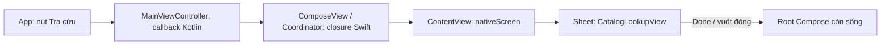

# Công thức phát triển màn hình iOS: Compose chung và giao diện native

Widget SwiftUI/UIKit nằm **trong** Compose có hướng dẫn riêng tại [iOS widget interop](ios-widget-interop.md), kèm mẫu số lượng đặt hàng đã tích hợp. Khi áp dụng các đoạn `MainViewController`/`ComposeView` dưới đây, ghép thay đổi vào source hiện tại và giữ `makeQuantityWidget`, `updateQuantityWidget`, `releaseQuantityWidget`, tham số `quantityWidget` và lời gọi `QuantityWidgetDemo`; các ví dụ màn hình không thay thế bridge widget này.

Tài liệu này là playbook để thêm tính năng vào dự án hiện tại. [Kiến trúc iOS](ios-ui-development.md) giải thích framework, source set và cách build tổng quát. **Hiện tại:** ứng dụng iOS mở `App()` của Compose làm root; nút mẫu mở sheet SwiftUI và UIKit qua callback. **Ví dụ đề xuất trong tài liệu:** `OrdersScreen`, `CatalogMatcher`, `CatalogLookupView`, `DeviceInfoView` và `CatalogSummaryCard` chưa được thêm vào source. Sao chép các đoạn liên quan khi triển khai tính năng thật; tên hành động nên phản ánh nghiệp vụ của sản phẩm.

Các công thức: [Compose chung](#1-thêm-màn-hình-compose-dùng-chung) · [SwiftUI riêng](#2-thêm-màn-hình-swiftui-riêng-dùng-logic-kotlin-chung) · [UIKit riêng](#3-màn-hình-uikit-riêng) · [đảo Compose trong SwiftUI](#4-đặt-một-vùng-compose-trong-màn-hình-swiftui) · [tính năng iOS không có màn hình](#5-tính-năng-ios-không-có-màn-hình-riêng) · [build trên Mac](#build-và-xác-minh-trên-macos).

## Chọn nơi đặt màn hình

| Nhu cầu | UI nên ở đâu | iOS làm gì | Nền tảng khác làm gì |
| --- | --- | --- | --- |
| Cùng luồng và bố cục cho nhiều nền tảng | `app/sharedUI/src/commonMain` | Root Compose hiển thị route đó | Dùng cùng composable/route |
| iOS cần bố cục riêng, logic vẫn chung | SwiftUI trong `app/iosApp/iosApp` | Compose gọi callback, SwiftUI mở sheet | Dùng UI riêng, cùng `sharedLogic` |
| Cần API UIKit hoặc màn hình UIKit chuyên biệt | UIKit trong `app/iosApp/iosApp` | Bọc `UIViewControllerRepresentable` để đặt vào sheet | Tích hợp nền tảng riêng |
| Chỉ một phần nhỏ UI chung ở màn hình SwiftUI | Composable trong `sharedUI`, factory ở `iosMain` | SwiftUI bọc một controller Compose cho phần đó | Dùng composable trực tiếp |
| Chỉ cần tính năng iOS, không cần màn hình mới | `iosMain` hoặc iOS host | Gọi dịch vụ nền tảng qua hợp đồng rõ ràng | Cung cấp hiện thực khác hoặc ẩn hành động |

Giữ dữ liệu và quy tắc nghiệp vụ trong `sharedLogic/commonMain` khi chúng thật sự dùng được ở nhiều nền tảng. Giữ state hiển thị của SwiftUI trong SwiftUI, state hiển thị của Compose trong Compose. Không chuyển `UIViewController`, `View` hay đối tượng UIKit vào `commonMain`.

Các ví dụ là những phần mở rộng cộng thêm vào source hiện tại. Nếu đã áp dụng một công thức hoặc [playbook Web](web-screen-recipes.md), giữ mọi tham số, nút và callback đã thêm; chỉ ghép thay đổi của công thức mới. `OrdersScreen` là màn hình chung, nên hai đội dùng cùng một file và chỉ đăng ký nó một lần trong `App()`.

## 1. Thêm màn hình Compose dùng chung

Ví dụ thêm route **Đơn hàng**. Tạo `app/sharedUI/src/commonMain/kotlin/com/example/fixvietnam_erp/OrdersScreen.kt`:

```kotlin
package com.example.fixvietnam_erp

import androidx.compose.foundation.layout.Column
import androidx.compose.foundation.layout.fillMaxSize
import androidx.compose.foundation.layout.safeContentPadding
import androidx.compose.material3.Button
import androidx.compose.material3.Text
import androidx.compose.runtime.Composable
import androidx.compose.ui.Modifier

@Composable
fun OrdersScreen(onBack: () -> Unit) {
    Column(modifier = Modifier.fillMaxSize().safeContentPadding()) {
        Text("Đơn hàng")
        Button(onClick = onBack) { Text("Quay lại") }
    }
}
```

**Đăng ký route trong `App()`** của `app/sharedUI/src/commonMain/kotlin/com/example/fixvietnam_erp/App.kt`. Mẫu hiện tại chưa dùng thư viện navigation, nên có thể dùng state route nhỏ. Giữ nguyên ba callback đang có trong chữ ký `App` (`onOpenNativeSwiftUI`, `onOpenNativeUIKit`, `onOpenWebCatalog`):

Thêm state ngay sau `{` của hàm `App`, **trước** `MaterialTheme` hiện có:

```kotlin
var showOrders by remember { mutableStateOf(false) }
var showContent by remember { mutableStateOf(false) }
```

`showContent` đã có trong source gốc: di chuyển dòng khai báo của nó từ trong `MaterialTheme` lên vị trí trên, không thêm bản thứ hai. Như vậy giá trị này còn khi quay lại Home từ màn Đơn hàng. `showOrders` là state mới.

Thêm nhánh ở **đầu** nội dung `MaterialTheme`, trước `Column` hiện có. Vì nhánh kết thúc bằng `return@MaterialTheme`, toàn bộ `Column` và ba callback hiện có được giữ nguyên khi ở trang gốc:

```kotlin
if (showOrders) {
    OrdersScreen(onBack = { showOrders = false })
    return@MaterialTheme
}
```

Trong `Column` hiện có, thêm nút cạnh các nút mẫu:

```kotlin
Button(onClick = { showOrders = true }) { Text("Đơn hàng") }
```

Các đoạn trên là **ba chỗ sửa trong file đang có**, không phải ba file thay thế. Giữ `Column`, `Modifier.safeContentPadding()`, `AnimatedVisibility` và các callback native/Web của `App`. Nếu dự án thêm Compose Navigation, đăng ký `OrdersScreen` trong graph chung thay cho biến Boolean. Ví dụ có nút Quay lại trong UI; xử lý Back/deep link của từng nền tảng cần được nối khi xây dựng navigation thật. Màn hình này **không cần** `UIViewController` hay Swift wrapper riêng: iOS đã render cây `App()` qua `MainViewController`, còn Android, Desktop và Web cũng gọi `App()`. Kết quả mong đợi: nút Đơn hàng mở màn hình Compose trên mọi nền tảng; nút Quay lại trở về màn hình chung; hai sheet native và nút Web vẫn hoạt động ở nền tảng tương ứng.

File cần thêm/sửa: `OrdersScreen.kt`, `App.kt`. Chỉ tạo `OrdersScreen.kt` mà không sửa `App.kt` thì màn hình chưa có route để mở.

## 2. Thêm màn hình SwiftUI riêng, dùng logic Kotlin chung

Ví dụ thêm màn hình **Tra cứu catalog**: UI nhập liệu và danh sách thuộc SwiftUI, còn quy tắc so khớp mã/tên dùng hàm Kotlin `matchesCatalogQuery` đã có trong `sharedLogic/commonMain`. Để Swift gọi API dễ dự đoán, ví dụ này thêm một lớp public có chữ ký chỉ gồm `String` và `Boolean`. `SharedUI` hiện đã `api(project(":app:sharedLogic"))` và `export(project(":app:sharedLogic"))`, nên lớp public mới thuộc module này có thể xuất sang Swift mà không cần framework thứ hai.

### Bước 1: tạo hợp đồng logic nhỏ

Tạo `app/sharedLogic/src/commonMain/kotlin/com/example/fixvietnam_erp/CatalogMatcher.kt`:

```kotlin
package com.example.fixvietnam_erp

class CatalogMatcher {
    fun matches(sku: String, name: String, query: String): Boolean =
        matchesCatalogQuery(sku, name, query)
}
```

Đây là lớp **đề xuất**, chưa có trong repo. Không đặt mã UIKit hay API Web trong lớp này. Khi build framework trên Mac, kiểm tra header Swift/Objective-C được sinh để xác nhận tên `CatalogMatcher` và nhãn tham số của `matches`; Kotlin/Native có thể điều chỉnh tên ở ranh giới Swift. Nếu tên sinh khác, sửa lời gọi Swift theo header, không phỏng đoán từ tên Kotlin.

### Bước 2: tạo màn hình SwiftUI

Tạo `app/iosApp/iosApp/CatalogLookupView.swift`:

```swift
import SharedUI
import SwiftUI

struct CatalogLookupView: View {
    private struct Item: Identifiable {
        let sku: String
        let name: String
        var id: String { sku }
    }

    private let items = [
        Item(sku: "SP-001", name: "Bộ dụng cụ sửa chữa"),
        Item(sku: "SP-002", name: "Găng tay bảo hộ"),
        Item(sku: "SP-003", name: "Đèn làm việc")
    ]
    private let matcher = CatalogMatcher()
    @State private var query = ""

    private var results: [Item] {
        items.filter { matcher.matches(sku: $0.sku, name: $0.name, query: query) }
    }

    var body: some View {
        List {
            Section {
                TextField("Mã hoặc tên sản phẩm", text: $query)
                    .textInputAutocapitalization(.never)
                    .autocorrectionDisabled()
                    .accessibilityLabel("Mã hoặc tên sản phẩm")
            }
            Section("\(results.count) sản phẩm phù hợp") {
                ForEach(results) { item in
                    VStack(alignment: .leading) {
                        Text(item.name)
                        Text(item.sku).font(.caption).foregroundStyle(.secondary)
                    }
                }
            }
        }
        .navigationTitle("Tra cứu catalog")
    }
}
```

Dữ liệu `items` ở đây là mẫu công khai, chưa phải dịch vụ catalog sản xuất. Với dữ liệu thật, đặt việc lấy/cập nhật dữ liệu trong lớp nghiệp vụ có vòng đời rõ ràng; dùng một bản ghi/model phù hợp thay vì chép dữ liệu vào cả Swift và Kotlin. Giữ `query` là state hiển thị SwiftUI; `CatalogMatcher` chỉ thực hiện quy tắc so khớp thuần. Xcode project dùng nhóm file đồng bộ với thư mục `iosApp/iosApp`, nên file Swift mới được nhận khi nằm đúng thư mục.

### Bước 3: nối hành động từ Compose đến iOS

Màn hình native được mở bởi root Compose. Nối đủ **bốn lớp**, đồng thời giữ hai hành động mẫu và callback Web hiện có:



1. `App` nhận callback tùy chọn `onOpenCatalogLookup: (() -> Unit)? = null`; trong `Column` hiện có, thêm nút `onOpenCatalogLookup?.let { open -> Button(onClick = open) { Text("Tra cứu catalog") } }`. Giữ nguyên `onOpenNativeSwiftUI`, `onOpenNativeUIKit`, `onOpenWebCatalog` và các nút của chúng. Android/Desktop/Web gọi `App()` hoặc cung cấp callback phù hợp; không hiện nút tra cứu iOS nếu callback vắng mặt.
2. `MainViewController` trong `sharedUI/src/iosMain` nhận thêm `onOpenCatalogLookup: () -> Unit` và chuyển vào `App`. Không thay framework hay tạo `CatalogLookupViewController` cho màn hình SwiftUI này.
3. `ComposeView` nhận closure mới, giữ nó trong `Coordinator`, truyền closure qua factory Kotlin và cập nhật nó trong `updateUIViewController`.
4. `ContentView` thêm trường hợp `.catalogLookup` cho `NativeScreen` và mở `CatalogLookupView()` trong `.sheet(item:)`. Sheet dùng cùng nút **Done**, đóng bằng nút hoặc vuốt xuống, root Compose vẫn được giữ.

Chữ ký `App` sau khi thêm tham số (giữ thứ tự tham số cũ, thêm ở cuối):

```kotlin
@Composable
fun App(
    onOpenNativeSwiftUI: (() -> Unit)? = null,
    onOpenNativeUIKit: (() -> Unit)? = null,
    onOpenWebCatalog: (() -> Unit)? = null,
    onOpenCatalogLookup: (() -> Unit)? = null,
) { /* giữ toàn bộ UI hiện có và thêm nút khi callback khác null */ }
```

Toàn bộ `MainViewController.kt` sau khi thêm callback:

```kotlin
package com.example.fixvietnam_erp

import androidx.compose.ui.window.ComposeUIViewController
import platform.UIKit.UIViewController

fun MainViewController(
    onOpenNativeSwiftUI: () -> Unit,
    onOpenNativeUIKit: () -> Unit,
    onOpenCatalogLookup: () -> Unit,
): UIViewController = ComposeUIViewController {
    App(
        onOpenNativeSwiftUI = onOpenNativeSwiftUI,
        onOpenNativeUIKit = onOpenNativeUIKit,
        onOpenCatalogLookup = onOpenCatalogLookup,
    )
}
```

`onOpenWebCatalog` vẫn nằm trong `App` với mặc định `null`; entry point Web hiện có vẫn truyền callback đó theo host Web. iOS không truyền callback Web, nên nút Web không hiện trên iOS.

Toàn bộ `ComposeView.swift` sau khi thêm closure:

```swift
import SharedUI
import SwiftUI
import UIKit

struct ComposeView: UIViewControllerRepresentable {
    var onOpenNativeSwiftUI: () -> Void
    var onOpenNativeUIKit: () -> Void
    var onOpenCatalogLookup: () -> Void

    final class Coordinator {
        var onOpenNativeSwiftUI: () -> Void
        var onOpenNativeUIKit: () -> Void
        var onOpenCatalogLookup: () -> Void

        init(
            onOpenNativeSwiftUI: @escaping () -> Void,
            onOpenNativeUIKit: @escaping () -> Void,
            onOpenCatalogLookup: @escaping () -> Void
        ) {
            self.onOpenNativeSwiftUI = onOpenNativeSwiftUI
            self.onOpenNativeUIKit = onOpenNativeUIKit
            self.onOpenCatalogLookup = onOpenCatalogLookup
        }
    }

    func makeCoordinator() -> Coordinator {
        Coordinator(
            onOpenNativeSwiftUI: onOpenNativeSwiftUI,
            onOpenNativeUIKit: onOpenNativeUIKit,
            onOpenCatalogLookup: onOpenCatalogLookup
        )
    }

    func makeUIViewController(context: Context) -> UIViewController {
        let coordinator = context.coordinator
        return MainViewControllerKt.MainViewController(
            onOpenNativeSwiftUI: { coordinator.onOpenNativeSwiftUI() },
            onOpenNativeUIKit: { coordinator.onOpenNativeUIKit() },
            onOpenCatalogLookup: { coordinator.onOpenCatalogLookup() }
        )
    }

    func updateUIViewController(_ uiViewController: UIViewController, context: Context) {
        context.coordinator.onOpenNativeSwiftUI = onOpenNativeSwiftUI
        context.coordinator.onOpenNativeUIKit = onOpenNativeUIKit
        context.coordinator.onOpenCatalogLookup = onOpenCatalogLookup
    }
}
```

`Coordinator` giữ closure mới nhất khi SwiftUI render lại representable. Không tạo `UIViewController` mới trong `updateUIViewController`; state bên trong root Compose cần tồn tại khi sheet đóng/mở.

Toàn bộ `ContentView.swift` sau khi thêm route native:

```swift
import SwiftUI

struct ContentView: View {
    private enum NativeScreen: String, Identifiable {
        case swiftUI
        case uiKit
        case catalogLookup

        var id: String { rawValue }

        var title: String {
            switch self {
            case .swiftUI: return "SwiftUI screen"
            case .uiKit: return "UIKit screen"
            case .catalogLookup: return "Tra cứu catalog"
            }
        }
    }

    @State private var nativeScreen: NativeScreen?

    var body: some View {
        ComposeView(
            onOpenNativeSwiftUI: { nativeScreen = .swiftUI },
            onOpenNativeUIKit: { nativeScreen = .uiKit },
            onOpenCatalogLookup: { nativeScreen = .catalogLookup }
        )
        .ignoresSafeArea()
        .sheet(item: $nativeScreen) { screen in
            NavigationStack {
                Group {
                    switch screen {
                    case .swiftUI: NativeGreetingView()
                    case .uiKit: NativeUIKitView()
                    case .catalogLookup: CatalogLookupView()
                    }
                }
                .navigationTitle(screen.title)
                .navigationBarTitleDisplayMode(.inline)
                .toolbar {
                    ToolbarItem(placement: .confirmationAction) {
                        Button("Done") { nativeScreen = nil }
                    }
                }
            }
        }
    }
}
```

Để giữ preview hiện có, có thể thêm lại `ContentView_Previews` phía cuối file như trong source hiện tại. Nếu màn hình native trả kết quả cho Compose, bổ sung hợp đồng dữ liệu hoặc state holder thay vì chỉ gửi sự kiện mở sheet. Thay đổi state SwiftUI từ callback bất đồng bộ cần chạy trên main actor; hủy subscription/task khi sheet đóng và tránh giữ closure sở hữu view lâu hơn vòng đời màn hình.

Kết quả mong đợi: iOS root Compose có thêm nút Tra cứu catalog; nút mở `CatalogLookupView` dưới dạng sheet; tìm kiếm dùng quy tắc Kotlin; Done hoặc vuốt xuống quay lại root Compose và giữ state hiện có. Hai nút mẫu SwiftUI/UIKit tiếp tục hoạt động. Android/Desktop/Web không hiện nút iOS mới, còn callback catalog Web vẫn hoạt động trên Web.

File cần thêm/sửa: thêm `CatalogMatcher.kt`, `CatalogLookupView.swift`; sửa `App.kt`, `MainViewController.kt`, `ComposeView.swift`, `ContentView.swift`. Chỉ tạo file view chưa đủ: phải đăng ký action và route ở bốn lớp trên. Build lại framework trước khi biên dịch Swift.

## 3. Màn hình UIKit riêng

Mẫu thật đã có: `NativeUIKitView.swift` chứa `UIViewControllerRepresentable` và `NativeGreetingViewController`, hiển thị `UILabel` với `Greeting()` từ `SharedUI`. Với một màn hình UIKit mới, ví dụ **Thông tin thiết bị**, tạo `DeviceInfoView.swift` trong `app/iosApp/iosApp`:

```swift
import SwiftUI
import UIKit

struct DeviceInfoView: UIViewControllerRepresentable {
    func makeUIViewController(context: Context) -> UIViewController {
        DeviceInfoViewController()
    }

    func updateUIViewController(_ controller: UIViewController, context: Context) {}
}

final class DeviceInfoViewController: UIViewController {
    override func viewDidLoad() {
        super.viewDidLoad()
        view.backgroundColor = .systemBackground

        let label = UILabel()
        label.text = "Thiết bị: \(UIDevice.current.model)"
        label.font = .preferredFont(forTextStyle: .body)
        label.adjustsFontForContentSizeCategory = true
        label.numberOfLines = 0
        label.translatesAutoresizingMaskIntoConstraints = false
        view.addSubview(label)
        NSLayoutConstraint.activate([
            label.leadingAnchor.constraint(equalTo: view.safeAreaLayoutGuide.leadingAnchor, constant: 24),
            label.trailingAnchor.constraint(equalTo: view.safeAreaLayoutGuide.trailingAnchor, constant: -24),
            label.topAnchor.constraint(equalTo: view.safeAreaLayoutGuide.topAnchor, constant: 24)
        ])
    }
}
```

Để mở từ Compose, thêm hành động có tên theo nghiệp vụ (ví dụ `onOpenDeviceInfo`) qua cùng bốn lớp ở công thức 2: `App` → `MainViewController` → `ComposeView`/`Coordinator` → `ContentView.NativeScreen`. Ở nhánh sheet mới, đặt `DeviceInfoView()`. Đừng gọi trực tiếp `DeviceInfoViewController` từ `commonMain`. Nếu màn hình UIKit nhận input SwiftUI có thể thay đổi, cập nhật controller trong `updateUIViewController`; mẫu trên không có input nên hàm rỗng.

Kết quả mong đợi: nút Compose mở sheet UIKit hiển thị thông tin thiết bị, Done/vuốt đóng về root Compose. File cần thêm/sửa: thêm `DeviceInfoView.swift`; sửa bốn lớp callback/route như công thức 2. Chỉ tạo `DeviceInfoView.swift` chưa khiến màn hình xuất hiện trong ứng dụng.

## 4. Đặt một vùng Compose trong màn hình SwiftUI

Trường hợp iOS có màn hình SwiftUI chính nhưng một thẻ tóm tắt cần chia sẻ UI với Android/Desktop: tạo composable nhỏ `CatalogSummaryCard` trong `app/sharedUI/src/commonMain/kotlin/com/example/fixvietnam_erp/CatalogSummaryCard.kt`:

```kotlin
package com.example.fixvietnam_erp

import androidx.compose.foundation.layout.Column
import androidx.compose.foundation.layout.padding
import androidx.compose.material3.Surface
import androidx.compose.material3.Text
import androidx.compose.runtime.Composable
import androidx.compose.ui.Modifier
import androidx.compose.ui.unit.dp

@Composable
fun CatalogSummaryCard() {
    Surface {
        Column(modifier = Modifier.padding(16.dp)) {
            Text("Danh mục sản phẩm")
            Text("3 sản phẩm mẫu")
        }
    }
}
```

Ở `app/sharedUI/src/iosMain/kotlin/com/example/fixvietnam_erp/CatalogSummaryViewController.kt`, tạo factory **riêng** cho đúng phần đó:

```kotlin
package com.example.fixvietnam_erp

import androidx.compose.ui.window.ComposeUIViewController
import androidx.compose.material3.MaterialTheme
import platform.UIKit.UIViewController

fun CatalogSummaryViewController(): UIViewController =
    ComposeUIViewController {
        MaterialTheme { CatalogSummaryCard() }
    }
```

Trong iOS, tạo `app/iosApp/iosApp/CatalogSummaryComposeView.swift` để bọc factory bằng `UIViewControllerRepresentable`:

```swift
import SharedUI
import SwiftUI
import UIKit

struct CatalogSummaryComposeView: UIViewControllerRepresentable {
    func makeUIViewController(context: Context) -> UIViewController {
        CatalogSummaryViewControllerKt.CatalogSummaryViewController()
    }

    func updateUIViewController(_ controller: UIViewController, context: Context) {}
}
```

Sau đó đặt vùng Compose vào màn hình SwiftUI cha, ví dụ `app/iosApp/iosApp/CatalogDetailView.swift`:

```swift
import SwiftUI

struct CatalogDetailView: View {
    var body: some View {
        VStack(alignment: .leading, spacing: 16) {
            Text("Chi tiết danh mục").font(.title)
            CatalogSummaryComposeView()
                .frame(height: 160)
            Text("Phần nội dung này do SwiftUI hiển thị.")
        }
        .padding()
    }
}
```

Đăng ký `CatalogDetailView` vào route/sheet SwiftUI nếu muốn người dùng mở nó; tạo file chưa tự tạo đường điều hướng. Kết quả mong đợi: thẻ summary do Compose vẽ nằm trong bố cục SwiftUI, còn toàn bộ root Compose của ứng dụng không bị lồng lần hai. **Không đặt `App()` làm đảo Compose**: `App` là root giao diện chung, có padding và điều hướng riêng. Với dữ liệu thay đổi, factory nên nhận một state holder Kotlin mà SwiftUI cập nhật khi input đổi; `updateUIViewController` rỗng chỉ phù hợp ví dụ không có input.

File cần thêm: `CatalogSummaryCard.kt`, `CatalogSummaryViewController.kt`, `CatalogSummaryComposeView.swift`, `CatalogDetailView.swift`; cần sửa route iOS nếu màn hình cha phải truy cập được từ app.

## 5. Tính năng iOS không có màn hình riêng

Ví dụ nút Compose **Sao chép mã sản phẩm** dùng clipboard iOS. Tính năng này không cần sheet hay file Swift mới. Thêm callback tùy chọn ở cuối chữ ký `App`, sau `onOpenWebCatalog`, giữ các callback hiện có:

```kotlin
onCopySku: ((String) -> Unit)? = null,
```

Trong `Column` của `App`, hiện nút khi host cung cấp callback:

```kotlin
onCopySku?.let { copySku ->
    Button(onClick = { copySku("SP-001") }) { Text("Sao chép mã") }
}
```

Tạo `app/sharedUI/src/iosMain/kotlin/com/example/fixvietnam_erp/Clipboard.ios.kt`:

```kotlin
package com.example.fixvietnam_erp

import platform.UIKit.UIPasteboard

fun copySkuToClipboard(sku: String) {
    UIPasteboard.generalPasteboard.string = sku
}
```

Trong `MainViewController.kt` hiện có, giữ nguyên chữ ký factory và **mọi callback đang chuyển tiếp** từ Swift đến `App`. Chỉ thêm named argument `onCopySku = ::copySkuToClipboard` vào lời gọi `App` đang có. Nếu bắt đầu từ source gốc, lời gọi sẽ là:

```kotlin
App(
    onOpenNativeSwiftUI = onOpenNativeSwiftUI,
    onOpenNativeUIKit = onOpenNativeUIKit,
    onCopySku = ::copySkuToClipboard,
)
```

Nếu đã áp dụng công thức 2, giữ thêm `onOpenCatalogLookup = onOpenCatalogLookup` trong cùng lời gọi `App` và giữ tham số factory tương ứng. Không thay lời gọi đã mở rộng bằng phiên bản chỉ có hai callback gốc ở trên; làm vậy sẽ khiến nút catalog native biến mất. Các callback khác được thêm sau này cũng phải được giữ.

`onOpenWebCatalog` vẫn do entry point Web cung cấp; các nền tảng khác không truyền `onCopySku` sẽ không thấy nút. `ComposeView.swift`, `Coordinator` và `ContentView.swift` không cần sửa vì thao tác clipboard đã được xử lý bên trong Kotlin `iosMain`. Kết quả mong đợi: iOS có nút Sao chép mã và clipboard chứa `SP-001`; Android/Desktop/Web không hiện nút iOS đó. Đây là dữ liệu mẫu, nên tính năng thật cần lấy SKU từ item đang chọn.

File cần thêm/sửa: `Clipboard.ios.kt`, `App.kt`, `MainViewController.kt`. Gọi clipboard từ sự kiện UI trên main thread. Clipboard là ví dụ không có kết quả bất đồng bộ. Với quyền truy cập, chia sẻ hệ thống hoặc picker có kết quả, định nghĩa rõ dữ liệu `success`/`cancelled`/`error`, chuyển kết quả qua callback hoặc state holder về Compose, và hủy/giải phóng delegate khi màn hình không còn sống. Những callback gọi từ luồng nền phải chuyển về main thread trước khi sửa state SwiftUI/Compose; không giữ controller hoặc closure quá vòng đời của host.

## Build và xác minh trên macOS

Project hiện xuất **một** framework tĩnh `SharedUI` cho `iosArm64` và `iosSimulatorArm64`; `sharedLogic` có iOS target nhưng không xuất framework độc lập. `app/sharedUI/build.gradle.kts` dùng `api(project(":app:sharedLogic"))` và `export(project(":app:sharedLogic"))`. Swift chỉ `import SharedUI`. Đừng thêm `SharedLogic.framework` vào Xcode cùng lúc; với framework tĩnh hiện có, không thêm bước nhúng dynamic framework vào **Embed Frameworks**. Nếu một kiểu từ `core` cần lộ trực tiếp trong chữ ký Swift, kiểm tra export/header và cấu hình thêm một cách tường minh.

Trên Mac, dùng Xcode có SDK iOS phù hợp; app đang đặt `IPHONEOS_DEPLOYMENT_TARGET = 18.2` (giá trị của dự án, không phải tối thiểu Compose), JDK **21 AZUL** cho Gradle daemon theo `gradle/gradle-daemon-jvm.properties`, và Android SDK vì Gradle cấu hình các module Android. Cập nhật `local.properties` theo SDK trên Mac. Chọn simulator Apple Silicon hoặc thiết bị `arm64`; target Intel simulator chưa được khai báo. Với thiết bị thật, điền signing team trong `app/iosApp/Configuration/Config.xcconfig` và kiểm tra bundle identifier.

Mở `app/iosApp/iosApp.xcodeproj` rồi Run. Xcode build phase gọi `/bin/sh ./gradlew :app:sharedUI:embedAndSignAppleFrameworkForXcode`; `Config.xcconfig` dùng `FRAMEWORK_SEARCH_PATHS = $(inherited) "$(SRCROOT)/../sharedUI/build/xcode-frameworks/$(CONFIGURATION)/$(SDK_NAME)"` và `OTHER_LDFLAGS = $(inherited) -framework SharedUI`. File `gradlew` hiện không có bit executable trong Git, nên lệnh terminal trên Mac dùng `sh ./gradlew`:

```sh
sh ./gradlew :app:sharedUI:linkDebugFrameworkIosSimulatorArm64
sh ./gradlew :app:sharedUI:iosSimulatorArm64Test :app:sharedLogic:iosSimulatorArm64Test
```

Hai task terminal kiểm tra Kotlin framework/test, **chưa biên dịch Swift**. Build app trong Xcode để kiểm tra cả Kotlin và Swift, thử mở/đóng sheet, giữ state Compose, safe area, bàn phím, Dynamic Type và VoiceOver. Trên Windows có thể chạy `./gradlew.bat :app:androidApp:assembleDebug :app:sharedUI:jvmTest :app:sharedLogic:jvmTest`, nhưng không xác nhận được iOS runtime/interop.

Nếu Swift báo không thấy `SharedUI`, kiểm tra build phase, framework search path, scheme và kiến trúc. Nếu không thấy `CatalogMatcher`/factory, kiểm tra kiểu là public, `export` và tên trong header được tạo; tên hàm top-level Swift thường theo tên file với hậu tố `Kt`. Nếu callback mở sheet nhưng đóng rồi mất state, kiểm tra `ComposeView` có bị thay identity hoặc tạo controller mới khi sheet đổi không. Nếu UI lệch safe area, nhớ root `ComposeView` dùng `.ignoresSafeArea()`, còn `App()` dùng `safeContentPadding()`; thử trên simulator có notch và bàn phím. Tất cả ví dụ mới ở tài liệu này cần được build trên Mac trước khi dùng trong production.
