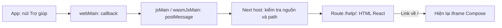

# Công thức thêm màn hình Web

Widget React nằm **trong** màn hình Compose có hướng dẫn riêng tại [Web widget interop](web-widget-interop.md), kèm mẫu số lượng đặt hàng đã chạy trong source. Các công thức màn hình dưới đây vẫn áp dụng; khi mở rộng `App()`/entry point đang có, giữ tham số `quantityWidget` và lời gọi `QuantityWidgetDemo` để không mất mẫu widget.

Tài liệu này là hướng dẫn sửa mã cho cấu hình **đang có**: Compose Multiplatform ở `/` (iframe JS hoặc Wasm) và Next.js App Router xuất HTML tĩnh cho `/catalog/`. Đọc [kiến trúc Web](web-ui-development.md) trước nếu cần hiểu vòng đời iframe, output build và giới hạn lưu state. Ví dụ `/help/` dưới đây **chưa được thêm vào sản phẩm**; các đoạn mã là những thay đổi cần thực hiện khi chọn triển khai ví dụ đó. Phần Vite cuối tài liệu chỉ là phương án thử nghiệm, chưa được cài trong repository.

- [Chọn đường triển khai](#chọn-đường-triển-khai)
- [Công thức 1: Màn hình Đơn hàng dùng chung bằng Compose](#công-thức-1-màn-hình-đơn-hàng-dùng-chung-bằng-compose)
- [Công thức 2: Trang trợ giúp React có HTML sẵn](#công-thức-2-trang-trợ-giúp-react-có-html-sẵn)
- [Công thức 3: Nút Compose mở trang React mới](#công-thức-3-nút-compose-mở-trang-react-mới)
- [Dùng Kotlin chung trong React](#dùng-kotlin-chung-trong-react)
- [Chạy, kiểm tra và triển khai](#chạy-kiểm-tra-và-triển-khai)
- [Phụ lục tùy chọn: thử React/Vite](#phụ-lục-tùy-chọn-thử-reactvite-chưa-có-trong-repository)

## Chọn đường triển khai

| Màn hình | Viết ở đâu | URL và HTML ban đầu | Khi nào chọn |
| --- | --- | --- | --- |
| Đơn hàng, tồn kho, luồng ERP sau đăng nhập | `app/sharedUI/src/commonMain`, đăng ký trong `App()` | Nằm trong iframe Compose tại `/`; nội dung ứng dụng được chạy bằng JS/Wasm | Muốn chia sẻ UI và hành vi với Android, iOS, Desktop; không cần lập chỉ mục từng màn hình. |
| Danh mục công khai, trợ giúp, trang thông tin | `app/webReact/app/<route>/page.tsx` | URL riêng như `/catalog/`, `/help/`; HTML được tạo tại build | Cần nội dung/metadata đọc được ngay từ HTML, liên kết sâu, kiểm soát DOM và khả năng truy cập. |
| Logic tra cứu/kiểm tra dùng ở cả hai | `app/sharedLogic/src/commonMain`; adapter JS ở `jsMain` khi React cần | Kotlin/JS package độc lập với bundle Compose JS/Wasm | Cùng quy tắc nghiệp vụ; không đồng nghĩa chia sẻ state giao diện. |

Việc tạo `OrdersScreen.kt` không tự đăng ký điều hướng Compose; việc thêm một path vào `REACT_ROUTES` cũng không tạo trang Next.js. Đây là hai việc riêng. React không tự mang lại SEO hay accessibility: HTML ban đầu, nhãn, cấu trúc, focus và kiểm thử thực tế mới quyết định kết quả.

Luồng của ví dụ nút Compose mở trang React ở công thức 3:



## Công thức 1: Màn hình Đơn hàng dùng chung bằng Compose

Ví dụ này tạo màn hình nội bộ đơn giản, xuất hiện trong ứng dụng Compose trên mọi nền tảng. Nếu đã tạo `OrdersScreen.kt` theo cookbook iOS, dùng lại **cùng file** và đăng ký một lần trong `App()`; không tạo bản Web riêng. Không tạo route `/orders/` ở Next. Dữ liệu hiển thị chỉ là mẫu; thay bằng state holder/repository của dự án khi kết nối dữ liệu thật.

**Bước 1.** Tạo `app/sharedUI/src/commonMain/kotlin/com/example/fixvietnam_erp/OrdersScreen.kt`:

```kotlin
package com.example.fixvietnam_erp

import androidx.compose.foundation.layout.Column
import androidx.compose.foundation.layout.fillMaxSize
import androidx.compose.foundation.layout.safeContentPadding
import androidx.compose.foundation.layout.padding
import androidx.compose.material3.Button
import androidx.compose.material3.Text
import androidx.compose.runtime.Composable
import androidx.compose.ui.Modifier
import androidx.compose.ui.unit.dp

@Composable
fun OrdersScreen(onBack: () -> Unit) {
    Column(modifier = Modifier.fillMaxSize().safeContentPadding().padding(16.dp)) {
        Text("Đơn hàng")
        Text("Danh sách đơn hàng sẽ được hiển thị tại đây.")
        Button(onClick = onBack) { Text("Quay lại") }
    }
}
```

Với Tồn kho, đổi tên thành `InventoryScreen` và đăng ký tương tự. Tách quy tắc tính tồn kho vào `sharedLogic/commonMain` khi nhiều nền tảng cùng dùng; composable chỉ giữ phần trình bày và state cần cho UI.

**Bước 2.** Trong `app/sharedUI/src/commonMain/kotlin/com/example/fixvietnam_erp/App.kt`, giữ nguyên chữ ký và mọi callback đang có. Đây là cùng cách đăng ký ở playbook iOS; nếu đội iOS đã thêm màn Đơn hàng, dùng lại nó và bỏ qua bước này. Các đoạn sau là ba chỗ sửa trong `App`, không thay cả file.

Ở đầu thân `App()`, trước `MaterialTheme`, thêm `showOrders`. Di chuyển dòng khai báo `showContent` hiện có từ bên trong `MaterialTheme` lên cạnh nó; chỉ giữ **một** khai báo `showContent`:

```kotlin
var showOrders by remember { mutableStateOf(false) }
var showContent by remember { mutableStateOf(false) }
```

Ở đầu nội dung `MaterialTheme`, trước `Column` hiện có, chèn nhánh mở màn hình:

```kotlin
if (showOrders) {
    OrdersScreen(onBack = { showOrders = false })
    return@MaterialTheme
}
```

Trong `Column` hiện có, thêm nút cạnh các nút mẫu:

```kotlin
Button(onClick = { showOrders = true }) { Text("Đơn hàng") }
```

Giữ nguyên modifier, mọi nút, callback native/catalog và `AnimatedVisibility` của `Column`. Android/Desktop tiếp tục gọi `App()` không tham số; iOS truyền callback native và Web truyền callback catalog như trước. Vì `showContent` ở ngoài nhánh màn hình, giá trị đó còn khi quay về Home; state nằm trong các component rời cây sẽ được tạo lại. Nếu cần khôi phục sau refresh, dùng cơ chế lưu state phù hợp. Biến Boolean chỉ minh họa một màn hình bổ sung, với nút Quay lại trong UI; khi có nhiều màn hình, dùng navigation graph và xử lý Back/deep link của từng nền tảng.

**Bước 3.** Chạy build Web ở cuối tài liệu và thử `/` với Wasm và `/?engine=js`. Để chạy Compose Wasm độc lập từ root trên Windows, dùng `./gradlew.bat :app:webApp:wasmJsBrowserDevelopmentRun` (hoặc `./gradlew.bat :app:webApp:jsBrowserDevelopmentRun` cho JS). Khi chạy độc lập, `isHybridWebHost()` là false nên nút catalog ẩn, nhưng nút Đơn hàng vẫn hoạt động. URL host vẫn là `/` khi đổi màn hình Compose; nếu cần deep link `/orders/` hoặc refresh giữ lại màn hình, phải thiết kế đồng bộ route Compose với URL, hiện dự án chưa có.

**Kết quả mong đợi:** ở cả hai engine, nút Đơn hàng mở `OrdersScreen` và Quay lại trở về Home; các nút native iOS và catalog Web vẫn xuất hiện đúng nền tảng. Truy cập `/orders/` trên host Next hiện trả 404 vì chưa có route Next tương ứng; host không tự biến mọi URL lạ thành màn hình Compose.

## Công thức 2: Trang trợ giúp React có HTML sẵn

Ví dụ `/help/` là trang công khai tĩnh. `app/webReact/app/layout.tsx` đã tạo `<html lang="vi">` và `hybrid-web-shell.tsx` đã tạo `<main id="main-content">`; trang mới không nên thêm `<main>` thứ hai. Next 16 trong repo hỗ trợ `metadata` ở Server Component `page.tsx`; `output: "export"` chạy component này lúc build và tạo `out/help/index.html` vì `trailingSlash: true`.

**Bước 1.** Tạo `app/webReact/app/help/page.tsx`:

```tsx
import type { Metadata } from "next";
import Link from "next/link";

function canonicalHelp(): string | undefined {
  const siteUrl = process.env.SITE_URL;
  if (!siteUrl) return undefined;
  try {
    const origin = new URL(siteUrl);
    if (origin.protocol !== "https:" && origin.protocol !== "http:") return undefined;
    return new URL("/help/", origin).toString();
  } catch {
    return undefined;
  }
}

export const metadata: Metadata = {
  title: "Trợ giúp",
  description: "Hướng dẫn tra cứu danh mục sản phẩm của FixVietnam ERP.",
  alternates: { canonical: canonicalHelp() },
};

export default function HelpPage() {
  return (
    <article className="page-container" aria-labelledby="help-title">
      <header className="page-intro">
        <h1 id="help-title">Trợ giúp tra cứu sản phẩm</h1>
        <p>Nhập mã hoặc tên sản phẩm để lọc danh mục mẫu.</p>
      </header>
      <section aria-labelledby="help-steps">
        <h2 id="help-steps">Các bước tra cứu</h2>
        <ol>
          <li>Mở <Link href="/catalog/">danh mục sản phẩm</Link>.</li>
          <li>Nhập mã hoặc tên vào ô “Mã hoặc tên sản phẩm”.</li>
          <li>Đọc số kết quả và danh sách sản phẩm phù hợp.</li>
        </ol>
      </section>
      <Link href="/">Về không gian làm việc</Link>
    </article>
  );
}
```

Nội dung ví dụ khớp hành vi của `/catalog/` hiện tại. Với trang chào hàng thực, thay bằng dữ liệu công khai đã được duyệt; không xuất thông tin tài khoản hoặc dữ liệu riêng của ERP vào SSG. `SITE_URL` chỉ được đọc khi build. Không đặt canonical localhost làm mặc định.

**Bước 2.** Cho người dùng tìm thấy trang: thêm `Link href="/help/"` vào `<nav>` ở `app/webReact/app/hybrid-web-shell.tsx`, cạnh liên kết catalog. Ví dụ:

```tsx
<Link href="/help/" aria-current={normalizedPath(pathname) === "/help/" ? "page" : undefined}>
  Trợ giúp
</Link>
```

`Link` tạo điều hướng nội bộ Next; nhập thẳng `/help/` hoặc refresh vẫn phải được static host phục vụ từ `out/help/index.html`. Nếu chỉ cần liên kết từ React, **dừng tại đây**: không cần callback Compose, `REACT_ROUTES` hoặc postMessage. `REACT_ROUTES` chỉ là danh sách path **được iframe yêu cầu host mở**; route thật do file `app/help/page.tsx` tạo ra. Một path có thể là route Next hợp lệ nhưng bị từ chối qua bridge Compose nếu chưa được thêm vào allowlist.

**Bước 3.** Kiểm tra HTML xuất ra, không chỉ nhìn giao diện sau hydration:

```powershell
npm run web:build
Select-String -Path app/webReact/out/help/index.html -Pattern '<title>Trợ giúp', '<h1', 'Các bước tra cứu', 'href="/catalog/"'
npm run web:preview
```

Mở tab mới tại `http://127.0.0.1:3000/help/`, refresh và thử dùng bàn phím. HTML phải có nội dung, title và description trước khi JavaScript chạy. Dùng heading theo cấp, liên kết cho điều hướng, button cho hành động, label cho input, trạng thái kết quả thông báo được, focus nhìn thấy và thử screen reader khi trang phức tạp. Next export cung cấp HTML ban đầu; mức accessibility cần được kiểm thử thực tế.

**Kết quả mong đợi:** `out/help/index.html` chứa h1, các bước, title/description và liên kết catalog; `/help/` mở được từ tab mới và sau refresh. Không có iframe Compose trên lần truy cập trực tiếp này.

## Công thức 3: Nút Compose mở trang React mới

Chỉ thực hiện phần này nếu cần một nút **trong Compose** mở `/help/`. Đây là luồng `App()` → callback `webMain` → triển khai `jsMain`/`wasmJsMain` → `postMessage` → allowlist host → `router.push`. Giữ callback `onOpenWebCatalog` và các callback iOS hiện có.

1. Trong chữ ký `App()` ở `app/sharedUI/src/commonMain/kotlin/com/example/fixvietnam_erp/App.kt`, thêm tham số tùy chọn cạnh catalog: `onOpenWebHelp: (() -> Unit)? = null`. Ở phần màn Home, sau nút catalog, thêm:

   ```kotlin
   onOpenWebHelp?.let { openScreen ->
       Button(onClick = openScreen) { Text("Trợ giúp") }
   }
   ```

   Nếu đã áp dụng Công thức 1, sửa ngay trên phiên bản `App()` mới của mình. Callback mặc định `null` giữ các lời gọi `App()` trên Android/Desktop và chữ ký iOS đang truyền hai callback native.

2. Trong `app/webApp/src/webMain/kotlin/com/example/fixvietnam_erp/main.kt`, giữ nguyên `openCatalog`, thêm `openHelp` và truyền vào `App`:

   ```kotlin
   val openCatalog: (() -> Unit)? = if (isHybridWebHost()) ::openReactCatalog else null
   val openHelp: (() -> Unit)? = if (isHybridWebHost()) ::openReactHelp else null
   ComposeViewport {
       App(onOpenWebCatalog = openCatalog, onOpenWebHelp = openHelp)
   }
   ```

   Kế bên hai `expect` hiện hữu, thêm `internal expect fun openReactHelp()`. `isHybridWebHost()` đã có và chỉ hiện nút khi Compose chạy trong iframe host; khi chạy standalone callback vẫn null.

3. Trong `app/webApp/src/jsMain/kotlin/com/example/fixvietnam_erp/ReactNavigation.js.kt`, giữ `openReactCatalog()` và thêm actual mới:

   ```kotlin
   internal actual fun openReactHelp() {
       js("window.parent.postMessage({type: 'fixvietnam:open-react-page', path: '/help/'}, window.location.origin)")
   }
   ```

4. Trong `app/webApp/src/wasmJsMain/kotlin/com/example/fixvietnam_erp/ReactNavigation.wasmJs.kt`, giữ file annotation `@file:OptIn(kotlin.js.ExperimentalWasmJsInterop::class)`, `hasParentHost()` và hai hàm catalog. Thêm hàm top level với `@JsFun`, rồi actual:

   ```kotlin
   @JsFun("() => { window.parent.postMessage({type: 'fixvietnam:open-react-page', path: '/help/'}, window.location.origin); }")
   private external fun requestReactHelp()

   internal actual fun openReactHelp() = requestReactHelp()
   ```

5. Trong `app/webReact/app/hybrid-web-shell.tsx`, đổi hằng số thành `new Set(["/catalog/", "/help/"])`. Phần listener hiện có đã kiểm tra `event.source === iframeRef.current?.contentWindow`, cùng origin, đúng `type`, path dạng string, rồi mới `router.push`. Không bỏ kiểm tra hoặc thay allowlist bằng đường dẫn do iframe tự chọn. Giữ `normalizedPath` để `/help` và `/help/` cùng trỏ tới route đã cho phép.

6. Chạy `npm run web:build`, `npm run web:check`, rồi preview. Thử nút ở cả `/?engine=js` và `/` mặc định Wasm; thử Compose → Help → Không gian làm việc. Khi quay lại qua `Link` trong cùng phiên, shell giữ iframe đã mount. Refresh trang hoặc mở trực tiếp `/help/` tạo phiên Compose mới khi về `/`.

**Kết quả mong đợi:** nút Trợ giúp chỉ xuất hiện ở Compose trong host, cả JS và Wasm đều mở `/help/`, nút catalog hiện hữu vẫn mở `/catalog/`, các callback native iOS còn nguyên. `App.kt` đã được thêm hành động theo cookbook iOS thì giữ mọi tham số đó và chỉ cộng thêm `onOpenWebHelp`.

**Danh sách file sau ba công thức:** `OrdersScreen.kt` và `App.kt` trong `sharedUI/commonMain` cho màn hình Compose; `app/webReact/app/help/page.tsx` và liên kết trong `hybrid-web-shell.tsx` cho route React. Chỉ khi Compose cần mở Help mới sửa tiếp `webApp/src/webMain/main.kt`, hai file `ReactNavigation` tại `jsMain`/`wasmJsMain`, và allowlist trong `hybrid-web-shell.tsx`. Không sửa `layout.tsx`, callback iOS hoặc `next.config.ts` cho ví dụ này.

Không cần tạo URL `app/webReact/app/orders/page.tsx` cho nút điều hướng **nội bộ Compose** ở Công thức 1. Ngược lại, path `/help/` cần file `page.tsx` ngay cả khi `REACT_ROUTES` đã cho phép nó.

## Dùng Kotlin chung trong React

API đã tồn tại: `matchesCatalogQuery(sku, name, query)` là quy tắc thuần trong `app/sharedLogic/src/commonMain/kotlin/com/example/fixvietnam_erp/CatalogSearch.kt`; adapter `@JsExport class WebCatalogSearch` nằm tại `src/jsMain/kotlin/com/example/fixvietnam_erp/web/WebCatalogSearch.kt`. Gradle tạo package `shared-logic` tại `app/sharedLogic/build/dist/js/productionLibrary/`, có `shared-logic.mjs` và kiểu `shared-logic.d.mts`. `app/webReact/package.json` dùng dependency `file:../sharedLogic/build/dist/js/productionLibrary`; TypeScript đọc kiểu được tạo từ Kotlin, không cần tự viết declaration giả.

Trong một Client Component React, dùng đúng API hiện hữu như `app/webReact/app/catalog/search.tsx`:

```tsx
"use client";
import { useState } from "react";
import { WebCatalogSearch } from "shared-logic";

const search = new WebCatalogSearch();
export function ProductMatch() {
  const [query, setQuery] = useState("");
  const found = search.matches("SP-002", "Găng tay bảo hộ", query);
  return (
    <div>
      <label htmlFor="product-query">Mã hoặc tên sản phẩm</label>
      <input id="product-query" value={query} onChange={(event) => setQuery(event.target.value)} />
      <p role="status">{found ? "Có sản phẩm phù hợp" : "Không có sản phẩm phù hợp"}</p>
    </div>
  );
}
```

Đây là ví dụ API, chưa phải component đang được import vào một route. Nếu dùng trong route, import và render rõ ràng từ `page.tsx`. Để trang SEO có dữ liệu ban đầu, nội dung chính phải có trong HTML build; `"use client"` không tự ngăn prerender nhưng `useEffect` fetch sau mount thì không cho crawler HTML ban đầu. Chỉ đưa logic Kotlin không phụ thuộc DOM/browser vào quá trình build Next; `WebCatalogSearch` hiện đáp ứng điều đó, còn API như `navigator` không phù hợp. Bản Kotlin/JS package cho React được build riêng với bản Kotlin/Wasm mà Compose dùng; không import trực tiếp bundle Wasm UI vào React.

Sau khi đổi API Kotlin, tạo lại library trước khi cài hoặc build host:

```powershell
npm run web:prepare
npm run web:install
npm run web:build
```

`web:prepare` cũng tạo bản phân phối Compose JS/Wasm, vì root script phục vụ toàn bộ site. `web:install` cần khi package hoặc lockfile đổi; lệnh này chạy bước chuẩn bị trước khi `npm install` của host. `web:build` tự chuẩn bị lại output trước khi Next build. Không sửa `build/dist`, `public/compose`, `out` hoặc `.d.mts` bằng tay. Logic thuần Kotlin được chia sẻ; state React, state Compose, iframe và session vẫn phải nối bằng URL, backend, storage hoặc thông điệp có hợp đồng rõ ràng.

## Chạy, kiểm tra và triển khai

Từ thư mục gốc repository trên PowerShell, cần JDK cho Gradle, Android SDK để cấu hình module và Node/npm tương thích với phiên bản Next trong `app/webReact/package.json`. Quy trình lần đầu:

```powershell
npm run web:install
npm run web:dev
```

`web:dev` mở Next dev server tại `127.0.0.1:3000`. Sau khi sửa Kotlin/Compose, chạy lại `web:prepare` và khởi động lại dev server để đảm bảo asset được chép mới. Kiểm tra bản phân phối:

```powershell
$env:SITE_URL = "https://erp.example.com"  # thay bằng origin production thật
npm run web:build
npm run web:check
npm run web:preview
```

Nếu chưa có domain production, bỏ `SITE_URL`; ví dụ `erp.example.com` chỉ là chỗ điền. `web:check` hiện kiểm tra catalog và hai engine hiện hữu, chưa tự kiểm tra `/help/` mới: xem `out/help/index.html` như Công thức 2 và thêm test phù hợp khi route được đưa vào sản phẩm. `web:preview` phục vụ `out/` tại `127.0.0.1:3000` với MIME `.wasm` phù hợp. Nếu cổng đang được `web:dev` dùng, dừng dev hoặc đặt `WEB_PREVIEW_PORT` khác trước khi preview.

Đường dẫn sinh ra: Kotlin/JS package ở `app/sharedLogic/build/dist/js/productionLibrary`; Compose tại `app/webApp/build/dist/js/productionExecutable` và `.../wasmJs/productionExecutable`; script `scripts/web.mjs` chép chúng sang `app/webReact/public/compose/js` và `/wasm`; Next xuất site cuối vào `app/webReact/out/`. Chỉ commit nguồn và lockfile; các thư mục build là output có thể tạo lại.

Kiểm tra thủ công theo thứ tự:

1. Vào `/` (Wasm mặc định) và `/?engine=js`; thử màn Compose mới ở cả hai. Thử Compose standalone nếu cần: callback mở trang React sẽ không xuất hiện ở đó.
2. Vào trực tiếp `/catalog/` và `/help/` bằng tab mới; refresh ở từng URL. Trang SEO phải hiển thị heading/nội dung trước hydration và không cần khởi động Compose.
3. Đi Compose → catalog/help → Compose bằng các liên kết nội bộ; kiểm tra state trong phiên còn giữ. Refresh, tab mới hoặc nhập URL trực tiếp sẽ tạo state mới. `?engine=js` được chọn khi iframe tạo lần đầu; liên kết fallback hiện dùng tải lại toàn trang. Chỉ đổi query bằng `router.push` trong cùng shell sẽ không đổi engine đã mount.
4. Dùng Tab, Shift+Tab, Enter và skip link; kiểm tra thứ tự focus, tên nút/liên kết, label input, trạng thái kết quả, độ tương phản và layout mobile. Thử NVDA hoặc VoiceOver cho trang quan trọng. Iframe là tài liệu accessibility riêng; thử đường đi focus qua ranh giới host/iframe.

Static host phải phục vụ `/help/` từ `out/help/index.html`, `/catalog/` từ `out/catalog/index.html`, `_next/` và `compose/{js,wasm}/` cùng origin. Đặt `.wasm` thành `application/wasm`. Nếu `/help/` chỉ hoạt động khi bấm Link nhưng refresh ra 404, lỗi nằm ở cấu hình phục vụ thư mục/route tĩnh. `output: "export"` không có SSR lúc request; dữ liệu công khai đổi phải build và phát hành lại. Nếu cần metadata hoặc nội dung thay đổi theo request, chuyển sang kiến trúc chạy server và thiết kế lại việc cache/xác thực; không đặt dữ liệu riêng tư vào HTML tĩnh.

Lỗi thường gặp: `shared-logic` không tìm thấy nghĩa là cần `web:prepare` trước `web:install`; API TypeScript lệch thì kiểm tra `shared-logic.d.mts` được sinh và cài lại package. Iframe trắng: mở trực tiếp `/compose/wasm/index.html` và `/compose/js/index.html`, kiểm tra đủ JS/Wasm asset và MIME; nếu chỉ Wasm lỗi, thử `/?engine=js`. Nút Compose không mở route React: kiểm tra callback được truyền từ `webMain`, cả hai actual JS/Wasm, `postMessage` đúng `type`/path/origin, host allowlist và file Next route. Nội dung SEO chỉ xuất hiện sau khi chạy JS: tìm dữ liệu đang được nạp trong `useEffect` hoặc từ API browser thay vì được render lúc build.

## Phụ lục tùy chọn: thử React/Vite (chưa có trong repository)

Không chạy các bước này nếu chỉ cần thêm màn hình vào cấu hình hiện tại. Project `fixvietnamerp` tham khảo dùng Vite + React CSR và import Kotlin/JS. Điều đó minh họa khả năng dùng logic Kotlin, nhưng Vite SPA mặc định **không** tạo HTML có nội dung riêng cho từng URL để bảo đảm SEO. Mẫu đang vận hành ở repository này là Next static export; đổi sang Vite cần thay thế cả phần route, metadata, prerender và build/deploy, không chỉ đổi lệnh bundler.

Muốn tạo prototype tách biệt ở `experiments/web-vite` (thư mục này chưa tồn tại), từ root chạy:

```powershell
npm run web:prepare
npm create vite@latest experiments/web-vite -- --template react-ts
Set-Location experiments/web-vite
npm install
npm install --install-links=false ../../app/sharedLogic/build/dist/js/productionLibrary react-router-dom
```

Package Kotlin tạo ra có tên `shared-logic`; kiểm tra `package.json` và `shared-logic.d.mts` trong thư mục productionLibrary trước khi import. Prototype dưới đây dùng React Router. Thay nội dung `src/main.tsx` do Vite tạo:

```tsx
import React from "react";
import ReactDOM from "react-dom/client";
import { BrowserRouter } from "react-router-dom";
import App from "./App";
import "./index.css";

ReactDOM.createRoot(document.getElementById("root")!).render(
  <React.StrictMode><BrowserRouter><App /></BrowserRouter></React.StrictMode>,
);
```

Thay `src/App.tsx` bằng prototype hoàn chỉnh này. Nó có route `/` giữ iframe Compose sau lần mở đầu, `/catalog/` dùng API Kotlin và `/help/` có HTML semantic. Khi đi từ Compose sang catalog, message dùng đúng hợp đồng hiện tại; nếu đã thêm nút Help theo Công thức 3, allowlist `/help/` cũng nhận thông điệp mới.

```tsx
import { useEffect, useRef, useState } from "react";
import { Link, Route, Routes, useLocation, useNavigate } from "react-router-dom";
import { WebCatalogSearch } from "shared-logic";

const allowed = new Set(["/catalog/", "/help/"]);
const search = new WebCatalogSearch();
const products = [
  { sku: "SP-001", name: "Bộ dụng cụ sửa chữa" },
  { sku: "SP-002", name: "Găng tay bảo hộ" },
];

function Catalog() {
  const [query, setQuery] = useState("");
  const rows = products.filter((p) => search.matches(p.sku, p.name, query));
  return (
    <section aria-labelledby="catalog-title">
      <h1 id="catalog-title">Danh mục sản phẩm mẫu</h1>
      <label htmlFor="query">Mã hoặc tên sản phẩm</label>{" "}
      <input id="query" type="search" value={query}
        onChange={(event) => setQuery(event.target.value)} />
      <p role="status">{rows.length} sản phẩm phù hợp</p>
      <table>
        <caption>Sản phẩm mẫu</caption>
        <thead><tr><th scope="col">Mã</th><th scope="col">Tên</th></tr></thead>
        <tbody>{rows.map((p) =>
          <tr key={p.sku}><th scope="row">{p.sku}</th><td>{p.name}</td></tr>
        )}</tbody>
      </table>
    </section>
  );
}

function Help() {
  return (
    <article>
      <h1>Trợ giúp tra cứu sản phẩm</h1>
      <p>Nhập mã hoặc tên sản phẩm để lọc danh mục mẫu.</p>
      <ol><li>Mở <Link to="/catalog/">danh mục</Link>.</li>
        <li>Nhập mã hoặc tên vào ô tìm kiếm.</li></ol>
    </article>
  );
}

export default function App() {
  const { pathname, search: queryString } = useLocation();
  const navigate = useNavigate();
  const mainRef = useRef<HTMLElement>(null);
  const frameRef = useRef<HTMLIFrameElement>(null);
  const previousPath = useRef(pathname);
  const [frameSource, setFrameSource] = useState<string | null>(null);
  const atHome = pathname === "/";

  useEffect(() => {
    if (atHome && frameSource === null) {
      const js = new URLSearchParams(queryString).get("engine") === "js";
      setFrameSource(js ? "/compose/js/index.html" : "/compose/wasm/index.html");
    }
  }, [atHome, frameSource, queryString]);

  useEffect(() => {
    if (previousPath.current !== pathname) {
      previousPath.current = pathname;
      mainRef.current?.focus();
    }
  }, [pathname]);

  useEffect(() => {
    function receive(event: MessageEvent) {
      if (event.origin !== window.location.origin ||
          event.source !== frameRef.current?.contentWindow) return;
      const data: unknown = event.data;
      if (typeof data !== "object" || data === null) return;
      const message = data as { type?: unknown; path?: unknown };
      if (message.type !== "fixvietnam:open-react-page" ||
          typeof message.path !== "string") return;
      const path = message.path.endsWith("/") ? message.path : `${message.path}/`;
      if (allowed.has(path)) navigate(path);
    }
    window.addEventListener("message", receive);
    return () => window.removeEventListener("message", receive);
  }, [navigate]);

  return <>
    <a className="skip-link" href="#content">Bỏ qua điều hướng</a>
    <nav aria-label="Điều hướng chính">
      <Link to="/">Không gian làm việc</Link>{" · "}
      <Link to="/catalog/">Danh mục</Link>{" · "}
      <Link to="/help/">Trợ giúp</Link>
    </nav>
    <main id="content" ref={mainRef} tabIndex={-1}>
      {frameSource && <div hidden={!atHome}>
        <iframe ref={frameRef} title="Không gian làm việc FixVietnam ERP"
          src={frameSource} className="compose-frame" />
      </div>}
      {atHome && !frameSource && <p>Đang mở không gian làm việc…</p>}
      {atHome && <p><a href="/?engine=js">Thử chế độ JS</a></p>}
      <Routes>
        <Route path="/" element={null} />
        <Route path="/catalog/" element={<Catalog />} />
        <Route path="/help/" element={<Help />} />
        <Route path="*" element={<p>Không tìm thấy trang.</p>} />
      </Routes>
    </main>
  </>;
}
```

Thay `src/index.css` bằng tối thiểu:

```css
body { margin: 0; font: 1rem/1.5 system-ui, sans-serif; color: #142433; }
nav, main { padding: 1rem; }
a { color: #075a9e; }
:focus-visible, main:focus-visible { outline: 3px solid #075a9e; outline-offset: 2px; }
.skip-link { position: absolute; top: -5rem; background: white; }
.skip-link:focus { top: 0; }
.compose-frame { display: block; width: 100%; height: 75vh; border: 0; }
label, input { display: inline-block; margin: .5rem; }
th, td { border: 1px solid #9baab8; padding: .5rem; }
```

Chép **toàn bộ** output Compose vào prototype. Sau `npm run web:prepare` ở root, từ `experiments/web-vite` chạy PowerShell:

```powershell
New-Item -ItemType Directory -Force public/compose/js, public/compose/wasm | Out-Null
Copy-Item ../../app/webApp/build/dist/js/productionExecutable/* public/compose/js/ -Recurse -Force
Copy-Item ../../app/webApp/build/dist/wasmJs/productionExecutable/* public/compose/wasm/ -Recurse -Force
npm run dev
```

Sau mỗi lần đổi Kotlin/Compose, chạy lại `npm run web:prepare` từ root rồi copy lại asset; đối với bản build Vite, tự động hóa bước copy này trước `npm run build` và phục vụ `dist/` với SPA fallback cho các đường dẫn React. Fallback chỉ dành cho route React: asset không tồn tại dưới `/compose/` phải trả lỗi 404, không trả HTML của SPA thay cho JS/Wasm. Giữ cùng origin cho host và iframe. Đừng chỉ chép `index.html`, vì JS và Wasm assets nằm cạnh nó. Prototype có kiểm tra origin/source/path, giữ iframe khi client navigation và focus vùng chính; nó vẫn chỉ là CSR. Khi vào thẳng `/help/`, HTML server trả về vẫn là shell Vite chứ chưa có nội dung trang Help. Đổi `?engine=` trong cùng phiên bằng client navigation không thay iframe đã mount; liên kết JS ở ví dụ tải lại trang.

`react-router-dom` chỉ điều hướng phía trình duyệt; nó không biến Vite CSR thành trang SEO. Để dùng Vite cho `/help/` công khai, chọn và kiểm chứng một lớp SSG/SSR tương thích với phiên bản React/Vite, tạo HTML và metadata riêng cho từng URL, thử direct request không chạy JS, rồi cấu hình host phục vụ deep link. Phải thay `metadata` export của Next bằng cơ chế head/prerender của lớp đó, thay `next/link` và App Router, thay `next build`/`out` cùng các test output. Nếu vẫn chỉ dùng Vite SPA, dành nó cho màn hình ERP nội bộ không phụ thuộc indexing; không nhận định rằng việc đổi từ Compose sang React/Vite CSR tự cải thiện SEO.
